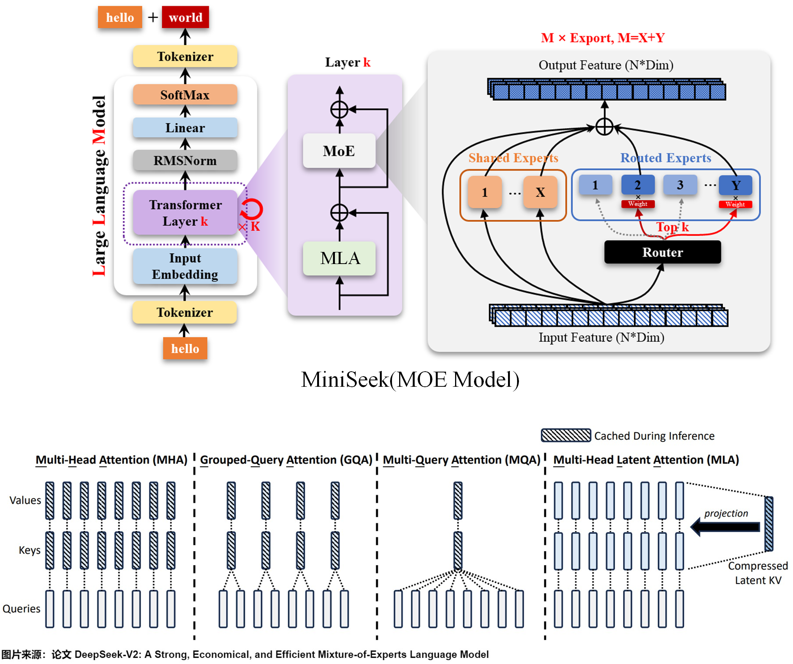

# MiniSeek-R1

**从预测下一个 token，到让模型比较同一道题的多个回答。** 这是一个面向初学者的中文小语言模型项目。你可以先在 CPU 上跑完一次微型训练，再沿着同一套代码学习监督微调、推理蒸馏和 GRPO。

  [](LICENSE)

[快速开始](#快速开始) · [训练路线](#训练路线) · [与模型对话](#与模型对话) · [模型与源码](#模型与源码)

## 快速开始

### 1. 安装环境

下面的命令从仓库根目录运行。使用 Python 3.10 创建虚拟环境。

```bash
git clone https://github.com/xi029/MIniSeek-R1.git
cd MIniSeek-R1
python -m venv .venv
```

Windows PowerShell 使用 `.\.venv\Scripts\Activate.ps1` 激活环境，Linux / macOS 使用 `source .venv/bin/activate`。然后安装依赖。

```bash
python -m pip install -r requirements.txt
```

### 2. 在 CPU 上跑完第一次训练

仓库自带分词器和四行中文样例。先看一条记录，再用 **64 维、2 层**的小模型学习预测下一个 token。

```bash
python view_dataset_samples.py --file examples/pretrain.jsonl --num 1
python trainer/train_pretrain.py --device cpu --data_path dataset/examples/pretrain.jsonl --hidden_size 64 --num_hidden_layers 2 --use_moe 0 --max_seq_len 64 --batch_size 2 --num_workers 0 --accumulation_steps 2 --save_weight demo
```

看到 `Step:2/2` 后，检查 `out/demo_64.pth`。四条样本组成两个批次，累积一次梯度更新。这个实验可以用来观察 loss、权重保存和重新加载，连贯的对话能力需要下一节的训练数据。

### 3. 看正式模型有多大

```bash
python params.py
python print_model_structure.py
```

第一个命令应显示 **95,052,288 个参数**。第二个命令会展开默认的 8 层 MoE 模型，可以对照第一层的注意力投影、路由器和专家网络阅读源码。两个命令均可离线运行。

## 训练路线

| 阶段 | 模型如何学习 | 所需数据文件 | 起始权重 → 输出前缀 |
| --- | --- | --- | --- |
| 预训练 | 从已有文本预测下一个 token | `pretrain_hq.jsonl` | 随机初始化 → `pretrain` |
| 监督微调（SFT） | 对照示范对话，学习生成助手回复 | `sft_mini_512.jsonl` | `pretrain` → `full_sft` |
| 推理蒸馏 | 从带推理过程的示范学习回答格式 | `r1_mix_1024.jsonl` | `full_sft` → `reason` |
| GRPO | 对同一提示采样多个回答，用组内相对得分更新策略 | `rlaif-mini.jsonl` | `reason` → `grpo` |

**准备数据。** 按阶段下载对应文件并放入 `dataset/`，也可以用 `--data_path` 指向已有文件。链接固定到原实验使用这些文件名的历史版本。全量训练数据、模型权重和断点由使用者在本地管理。 [数据集文件列表](https://huggingface.co/datasets/jingyaogong/minimind_dataset/tree/84983ed4dec7836d240577760c1d6be5d4cabcf9) · [本项目的数据格式示例](dataset/README.md)

按顺序执行需要的阶段。各阶段须使用一致的隐藏维度、层数和 MoE 配置。正式训练建议使用 CUDA，显存不足时先减小 `--batch_size`。

```bash
python trainer/train_pretrain.py
python trainer/train_full_sft.py
python trainer/train_distill_reason.py
```

GRPO 还需要一个奖励模型。已有奖励模型时，可将其目录传给 `--reward_model_path` 并跳过下载步骤。

```bash
python download_model.py
python trainer/train_grpo.py --reasoning 1
```

模型权重保存在 `out/`，如 `reason_512_moe.pth`。训练断点保存在 `checkpoints/`，包含优化器等续训状态。用 `--from_resume 1` 恢复对应阶段。需要记录曲线时，先执行 `python -m pip install swanlab==0.6.8`，再为训练命令添加 `--use_wandb`（历史参数名，实际使用 SwanLab）。

<details>
<summary>可选实验 · 用偏好数据做 DPO</summary>

准备 `dataset/dpo.jsonl` 和已完成的 SFT 权重后，执行 `python trainer/train_dpo.py`。每条样本包含针对同一提问的优选和次选对话。DPO 分支默认从 `full_sft` 生成 `dpo` 权重。主线的推理蒸馏默认从 `full_sft` 开始。

</details>

## 与模型对话

获得 `out/full_sft_512_moe.pth` 后即可在终端提问。完成推理或 GRPO 训练后，把 `--weight` 改成 `reason` 或 `grpo`，可加 `--enable_thinking`。权重在其他位置时，用 `--save_dir` 指向所在目录。

```bash
python test_llm.py --weight full_sft
```

网页演示支持本地权重、导出的 Transformers 目录，以及兼容 Chat Completions 的 API。启动后打开终端显示的本地地址，在侧栏选择模型来源。

```bash
python -m streamlit run web_demo.py
```

如需将权重交给另一套 Transformers 程序，可将模型配置、自定义模型代码、权重与分词器一并导出。本项目导出的目录通过 `trust_remote_code=True` 加载其中的模型实现。

```bash
python convert_model.py --input_model out/full_sft_512_moe.pth --output_dir exports/full_sft
python eval_llm.py --load_from exports/full_sft --weight full_sft
```

## 模型与源码

默认训练配置使用 512 维隐藏状态、8 层、8 个查询头和 2 个 KV 头，词表大小为 6,400。注意力层将 Q、K 的部分维度用于 RoPE，缓存展开后的 K、V。MoE 层对每个 token 从 4 个路由专家中选 2 个，同时计算 1 个共享专家。

| 想弄清楚的问题 | 从这里读起 |
| --- | --- |
| 一行文本如何变成输入、目标和损失掩码？ | [dataset/lm_dataset.py](dataset/lm_dataset.py) |
| token 如何经过注意力层、路由器和专家？ | [model/model_miniseek.py](model/model_miniseek.py) |
| 梯度何时累积，何时更新权重？ | [trainer/train_pretrain.py](trainer/train_pretrain.py) |
| 微调和推理蒸馏的训练目标有何区别？ | [监督微调](trainer/train_full_sft.py) · [推理蒸馏](trainer/train_distill_reason.py) |
| 一个回答的奖励如何变成梯度？ | [trainer/train_grpo.py](trainer/train_grpo.py) |

<details>
<summary>展开项目原有的架构学习图</summary>



图中并列展示了几种注意力设计以供学习。本项目的投影和缓存形状可在源码的 `MultiHeadLatentAttention.forward` 中逐项核对。 [注意力对照图](docs/images/attention-variants.jpg) · [原始图解笔记](docs/images/attention-notes.png) · [实验记录](docs/experiments.md)

</details>

## 致谢与许可

模型、训练代码和分词器基于 MiniMind 项目，注意力与路由实验参考了 DeepSeek 的设计，GRPO 实验使用 InternLM2 奖励模型。 [MiniMind](https://github.com/jingyaogong/minimind) · [DeepSeek-V3](https://github.com/deepseek-ai/DeepSeek-V3) · [InternLM2 Reward](https://huggingface.co/internlm/internlm2-1_8b-reward)

本仓库原创部分采用 MIT 许可。MiniMind 衍生部分保留上游 Apache 2.0 许可，外部数据和奖励模型按各自来源的条款使用。 [仓库许可证](LICENSE) · [MiniMind 许可证](licenses/MiniMind-LICENSE)
