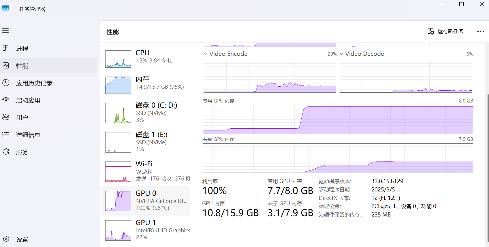

# 原项目实验记录

旧项目在 2025 年 12 月留下了两组预训练笔记。下表记录当时写下的配置，便于阅读已有权重和训练日志。

| 隐藏维度 | 笔记中的参数量 | 轮数 | 批次大小 | 数据 |
| --- | --- | --- | --- | --- |
| 640 | 约 145.03M | 3 | 64 | `pretrain_hq.jsonl` |
| 512 | 约 95.05M | 1 | 64 | `pretrain_hq.jsonl` |

旧目录保存了 512 维 MoE 实验的 `pretrain`、`full_sft`、`reason`、`grpo` 四组权重。运行 `python params.py` 可以重新计算 512 维配置的参数总数。

实验时观察到，模型参数的大小只能解释一部分显存占用。训练还需要存放梯度、优化器状态和前向激活。下图是一次运行中的系统监视器截图，具体批次、精度和训练阶段未记录。

